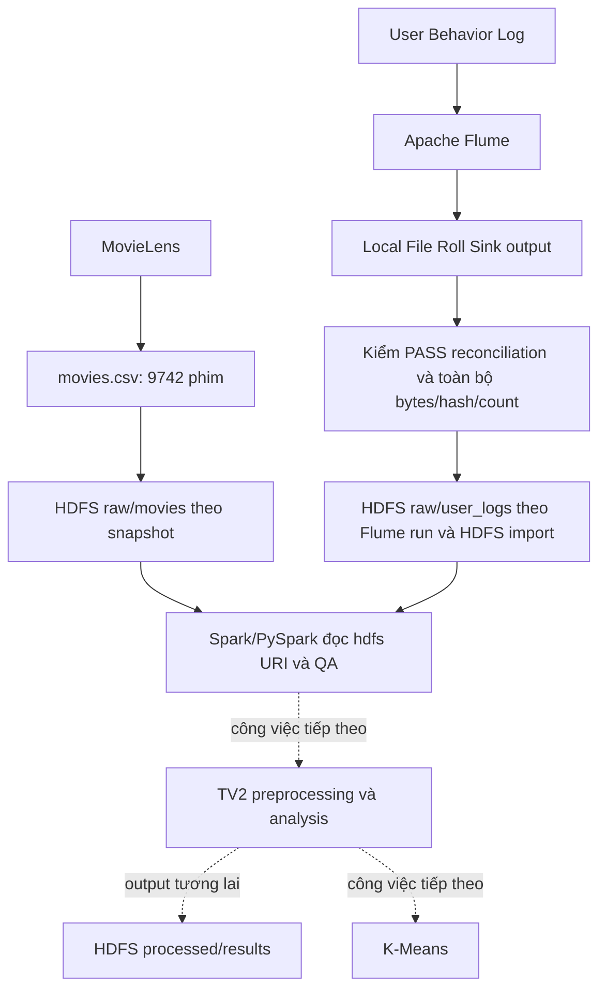

# Kiến trúc Tuần 2 với HDFS

Chọn nguồn bằng --flume-run-id, hiện tại run-f63c810e9d8d: reconciliation PASS,
254 Sink parts, 1.000.000 events. Runner tạo cluster/import ID riêng;
trạng thái remote phải đọc từ evidence của context hiện tại.

Tuần 1: log → Flume → local Sink → local Spark smoke test.
Tuần 2: log → Flume → Sink output → HDFS → Spark/PySpark. Metadata vào HDFS
riêng rồi join movieId. Không upload generated input thay Sink; File Roll Sink
vẫn ghi local. Import không overwrite; file tồn tại chỉ skip khi size/SHA256 khớp.
Verifier kiểm hai raw namespaces, không nhầm processed/results hoặc snapshot khác
thành file thừa.

NameNode namenode:9000, DataNode datanode:9866, hai named volumes riêng theo
Compose project; Spark cùng network với Hadoop XML. UI loopback 19870;
replication 1, không HA/dự phòng. Runner kiểm DataNode live/safe mode OFF.
Report trong hdfs-385a18d3f03a là lịch sử, không tự chứng minh runtime ở máy này.
[Commands và hợp đồng HDFS](week2_tv2_hdfs_handoff.md).
