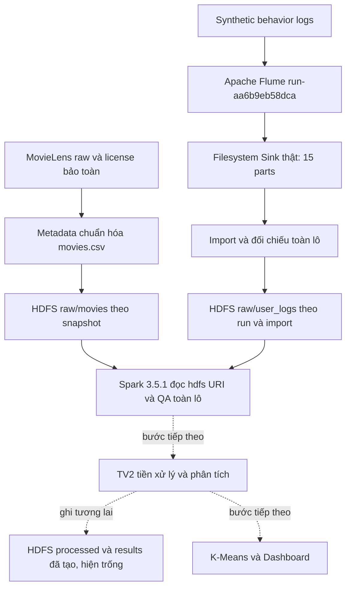

# Kiến trúc hệ thống sau bổ sung HDFS

Snapshot triển khai: `hdfs-385a18d3f03a`, ngày 12/10/2026. Sơ đồ mô tả đúng đường dữ liệu đã chạy; nhánh nét đứt là công việc tiếp theo.

| Thành phần | Trạng thái trong lượt này | Bằng chứng |
|---|---|---|
| MovieLens → normalized metadata | ĐẠT, kế thừa nguồn đã kiểm lại | `source_manifest.json`, metadata SHA256 |
| Generated → Flume → filesystem Sink | ĐẠT, run Tuần 1 được xác minh lại; không chạy lại main | `evidence/run-aa6b9eb58dca/reconciliation.json` |
| Import → HDFS | ĐẠT, 1 NameNode + 1 DataNode, replication 1 | `content-import.json`, `content-after-restart.json` |
| HDFS → Spark QA | ĐẠT, 9.742 phim + 1.000.000 events, mọi nhóm lỗi 0 | `spark-hdfs.json` |
| Tiền xử lý chuyên sâu/phân tích/K-Means/dashboard | CHƯA THỂ XÁC MINH, thuộc công việc tiếp theo và chưa chạy | Không có kết quả giả định |

Metadata và logs gặp nhau ở Spark thông qua LongType movieId; full left anti join hiện không có orphan event. Log là synthetic; simulatedMovieDuration không phải runtime thực tế của MovieLens. Flume chưa được đổi sang HDFS Sink; upload filesystem → HDFS là bước riêng, có source manifest, chống ghi đè và đối chiếu bytes/hash/count.

HDFS URI sử dụng `namenode:9000` và DataNode `datanode` trong network `movie-hdfs-385a18d3f03a_default`. Named volumes cùng project giữ metadata và blocks. UI host là `http://127.0.0.1:19870`; Spark chạy trong cùng network. Một máy, một DataNode, replication 1 không có HA/dự phòng. Chưa nhận xác nhận kiến trúc của nhóm hoặc xác nhận tích hợp TV2; sơ đồ là trạng thái triển khai đã kiểm chứng của TV1.

Tài liệu cấu hình, schema, commands và điều kiện truy cập: [Hợp đồng TV2](week2_tv2_hdfs_handoff.md). Cơ sở lý thuyết và số liệu: [Chương HDFS](week2_tv1_hdfs_report.md).
