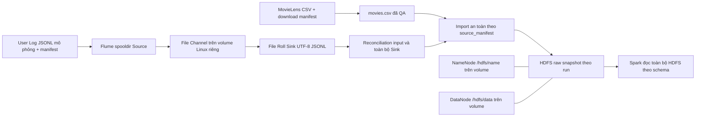

# Kiến trúc triển khai Tuần 3 — thành viên 1

Deployment đo từ `runtime-before.json` và command `cluster-inspect`: project/cluster ID lấy từ context, không tạo hạ tầng mới. Service hostname `namenode:9000`; NameNode Web UI bind loopback host; một DataNode đăng ký, replication=1. Repo bind `/project`; hai named volume giữ metadata/block, Flume Channel có volume riêng theo UUID run. Không có Flume HDFS Sink: File Roll Sink local được kiểm rồi import bằng Hadoop Java client trong Spark container.

Nguồn chính thức được chọn bằng context + acceptance PASS, source manifest ghi URI, count và từng part hash. Import dùng `copyFromLocalFile(...overwrite=False)`, existing target phải khớp SHA256 mọi byte; list namespace phải chính xác. Movies không qua Flume; log generated chỉ dùng lineage, log upload chỉ là Sink. Snapshot demo/stability riêng và không thay official input của Spark/Dashboard.

Spark chạy `local[2]` trong Docker, truy cập HDFS qua mạng Compose và hostname DataNode. Đây là triển khai học phần một host; không mô tả Spark là cluster nhiều worker hoặc HDFS là HA. Persistence được đo qua restart cùng container/volume, kiểm VERSION, health và toàn bộ SHA256 trước/sau; không phải kiểm khả năng chịu mất DataNode.

Xem [README vận hành](../README.md) và [demo](week3_tv1_demo.md). Bằng chứng thực đo: `evidence/week3-tv1/tv1-20261015-a91e7b2c/`.
